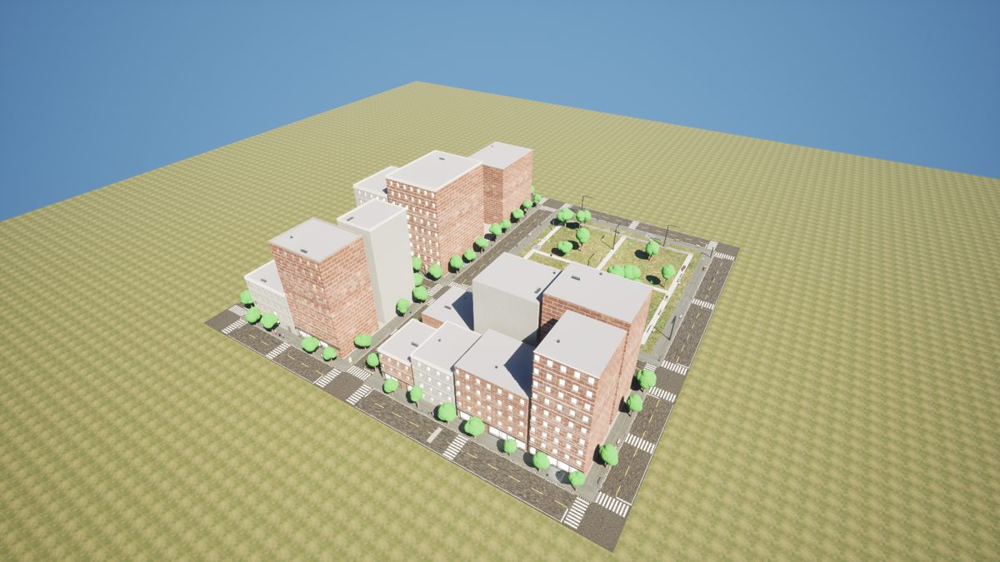
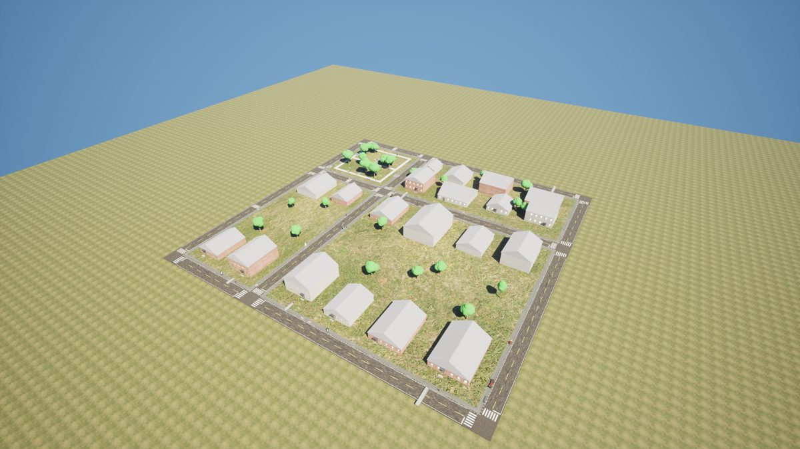
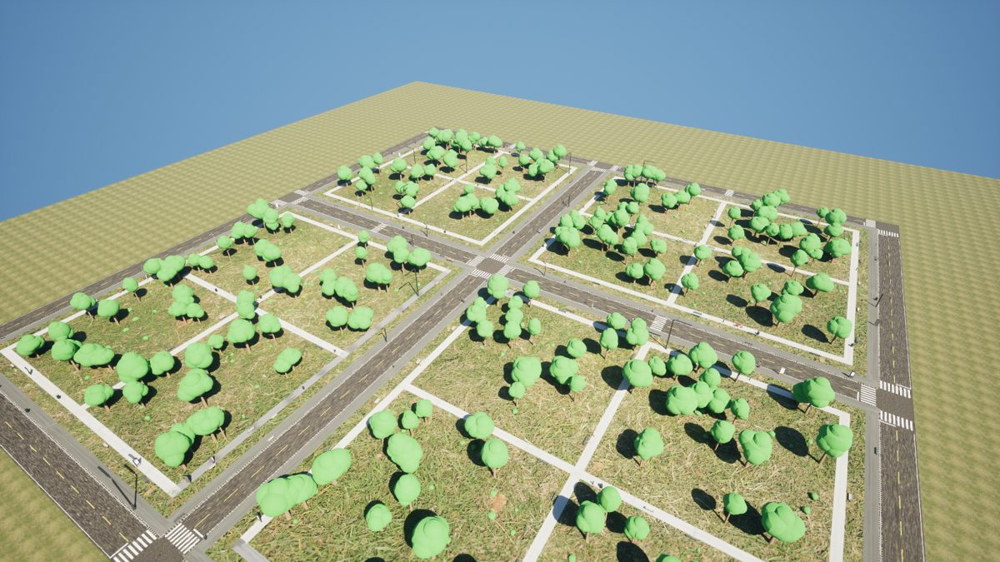
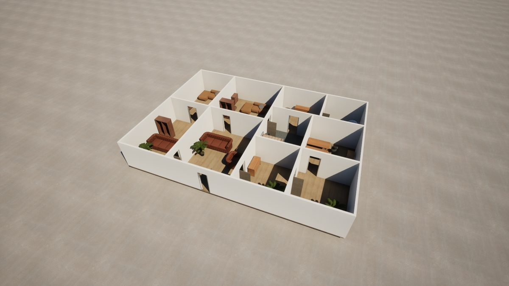
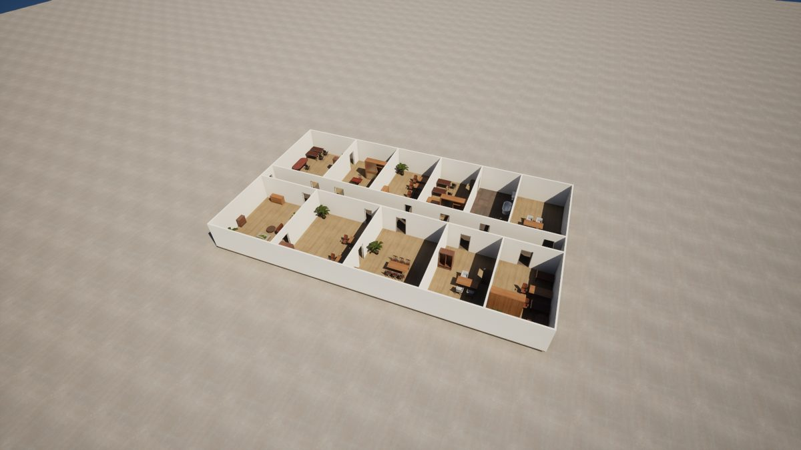

# RammsWorldGen

Seed-driven generation and randomization of pedestrian / wheelchair
environments for RAMMS, built on UE 5.8 PCG: street grids with sidewalks,
curb ramps and crosswalks; building shells with level, stepped and ramped
entrances; street furniture and the hazards that narrow a route; suburban
lots, lawns and parks; and indoor layouts with doors, thresholds and
furniture. Every world comes with a **ground-truth manifest** that says where
the routes are, how wide they really are, and which features break the
accessibility profile — so an episode knows which curb, door or A-frame is
the hard one.


> **Repository layout.** This plugin is developed in
> [rammp-org/ramms-worldgen](https://github.com/rammp-org/ramms-worldgen) and
> used by [ramms-sim](https://github.com/rammp-org/ramms-sim) as a submodule at
> `Plugins/RammsWorldGen`. The plugin carries its content (`/RammsWorldGen/`:
> graphs, presets, ADA profile, palette and materials, all rebuilt from
> `Content/Python/ramms_worldgen`). The palette and materials point at the
> project's Fab / marketplace packs, which are not part of this repo; without
> them palette slots stay empty and materials use default textures. Paths
> below like `Scripts/worldgen/`, `doc/world_generation.md` and
> `Content/Maps/Gen/` belong to ramms-sim (build / verify scripts and the
> example levels).

```
preset (params + palette + profile + graph)  ──►  ARammsWorldGenerator (seed)
                                                        │  PCG graph
          Street Network ─► Subdivide Lots ─► Building Massing
                 │                │
                 │                └─► Park Layout ─┐
                 └─► Hazard Placer ◄───────────────┘
                          │
   Primitives (ISM cubes + materials)   Props (Fab meshes)   Pieces (ARammsProcPiece actors)
                          └──────────────── Manifest ──────────────────┘
                                                        │
                                              FRammsWorldManifest (JSON)
```

The five example levels (`Content/Maps/Gen/Map_Gen_*`, built by `Scripts/worldgen/build_levels.py`):

| Downtown (seed 7) | Suburban (seed 11) | Park (seed 3) |
|---|---|---|
|  |  |  |

| Indoor home (seed 5) | Office (seed 2) |
|---|---|
|  |  |

## Contents

- [How it fits together](#how-it-fits-together)
- [Building](#building)
- [First run](#first-run)
- [Using it](#using-it)
  - [In the editor](#in-the-editor)
  - [From Python](#from-python)
  - [From an AI assistant (MCP)](#from-an-ai-assistant-mcp)
  - [At runtime](#at-runtime)
- [The manifest](#the-manifest)
- [Segmentation labels](#segmentation-labels)
- [Parameters](#parameters)
- [Extending](#extending)
- [UrbanVerse assets](#urbanverse-assets)
- [SimReady assets](#simready-assets)
  - [Articulated SimReady assets in MuJoCo](#articulated-simready-assets-in-mujoco)
- [Design notes and limits](#design-notes-and-limits)
- [First-compile checklist](#first-compile-checklist)

## How it fits together

| Layer | What | Where |
|---|---|---|
| **Data assets** | `URammsWorldPreset` (scene kind, params, palette, profile, graph), `URammsWorldPalette` (semantic slots → Fab meshes / materials / actor classes), `URammsAccessibilityProfile` (ADA thresholds + the ranges used to break them on purpose) | `Source/.../Public/RammsWorld*.h`, instances under `/RammsWorldGen/` |
| **Generator** | `ARammsWorldGenerator`: owns the `UPCGComponent`, a seed, a preset; flattens preset + profile + per-instance overrides into `FRammsWorldGenParams`; `Regenerate()` / `Randomize()` / `Cleanup()`; builds the manifest after generation; `PlacePlayerStart()`; `ExportManifest()` | `RammsWorldGenerator.h` |
| **Procedural pieces** | `ARammsProcPiece`: a GeometryScript dynamic mesh whose dimensions decide usability — curb ramps with flares and detectable-warning strips, curbs, steps, ramps with landings and edge protection, walls with door openings, door leaves and thresholds, bollards, planters, low-poly trees and shrubs. Spawned by PCG's Spawn Actor with every property mapped from a same-named point attribute. Complex-as-simple collision. | `RammsProcPiece.h` |
| **PCG nodes (C++)** | `Ramms: Street Network`, `Subdivide Lots`, `Building Massing`, `Park Layout`, `Hazard Placer`, `Indoor Layout`, `Manifest`. Deterministic by seed. They emit *oriented points with attributes*; stock spawners do the placing. | `Public/PCG/*.h` |
| **Graphs** | `PCG_Streets` (downtown, suburban, park, main street) and `PCG_Indoor` (home, office, store), both ending in the shared subgraph `PCG_SpawnAndRecord`; **built from code** by `ramms_worldgen.graphs` so they are reviewable and reproducible (see `doc/world_generation.md`, "The PCG graphs"). | `/RammsWorldGen/Graphs/` |
| **Python** | Graph builder DSL, palette/preset builders, example-level assembly, MCP toolset | `Content/Python/ramms_worldgen/` |

The one wiring rule: each custom node's overridable properties are named
exactly like the members of `FRammsWorldGenParams`, and the graph feeds a
single **Get Actor Property (Self, `Params`)** attribute set into every
node's **Overrides** pin. Adding a parameter is: add a member to the struct,
add a same-named `PCG_Overridable` property to the node that uses it, done.

Points carry three families of attributes:

- **Spawner inputs**: `Mesh` (soft path) and, for primitives, `Material`
  (slot-0 override). Primitives are `/Engine/BasicShapes/Cube` instances
  scaled to size, which is how roads, sidewalks, floors, building shells,
  windows and crosswalk bars are drawn with the Megascans surface materials.
- **Piece properties**: `KindId`, `SizeX/Y/Z`, `Rise`, `Slope`, `FlareSlope`,
  `StepCount`, `OpeningWidth/Offset/Height`, `LandingSize`, `WarningDepth`,
  `MaterialPath`, `MaterialPath2` — the Spawn Actor node maps each onto
  `ARammsProcPiece` and then calls `Rebuild()`.
- **Manifest**: `ManifestKind`, `ManifestSubtype`, `bCompliant`, `IssueId`,
  `Measure`, `Threshold` — read by the Manifest node for mesh-spawned
  features, and reported by the pieces themselves for actors.

## Building

The plugin is a Runtime module (`RammsWorldGen`) depending on `PCG`,
`GeometryScriptingCore`, `GeometryFramework`, `GeometryCore`, `Json` and
`JsonUtilities`. The `.uplugin` enables `PCG`, `GeometryScripting` and
`PythonScriptPlugin`; the project `.uproject` enables `RammsWorldGen`.

```powershell
$UE = "C:\Program Files\Epic Games\UE_5.8"
& "$UE\Engine\Build\BatchFiles\Build.bat" RammsEditor Win64 Development -Project="$PWD\Ramms.uproject" -WaitMutex
```

Reflection changes (any `UPROPERTY`/`UCLASS` here) need the full build, not
Live Coding — same rule as the rest of the project.

## First run

1. Build and open the editor. The Output Log should show
   `[RammsWorldGen] registered RammsWorldGenToolset with the toolset registry.`
2. Make sure the Fab packs are present (`Content/Fab/MoStreetProps`,
   `Megascans`, `FreeFurniturePack`, `RestaurantScene`, `Stairs_Street`,
   `adoquines_levantados_alcorque`). They are not committed; see the project
   README. Missing packs only leave palette slots empty (procedural stand-ins
   take over), they do not stop generation.
3. Build the assets from code:
   ```
   python Scripts/editor_remote_exec.py --file Scripts/worldgen/build_assets.py
   ```
   or, in the editor's Python console, `import ramms_worldgen.build_all as b; b.build("all")`,
   or ask the assistant for `worldgen_build_assets`. This writes
   `/RammsWorldGen/Palettes/PAL_Default`, `/RammsWorldGen/Profiles/PROF_ADA`,
   `/RammsWorldGen/Presets/PRE_*`, and `/RammsWorldGen/Graphs/PCG_Streets`,
   `PCG_Indoor` and `PCG_SpawnAndRecord`. The report lists every palette slot it could not fill.
4. Build the example levels:
   ```
   python Scripts/editor_remote_exec.py --file Scripts/worldgen/build_levels.py
   ```
   Creates `/Game/Maps/Gen/Map_Gen_Downtown`, `Map_Gen_Suburban`,
   `Map_Gen_Park`, `Map_Gen_Indoor`, `Map_Gen_Office`, `Map_Gen_MainStreet` and
   `Map_Gen_Store`, each with lights, a
   ground slab, a `WorldGenerator`, the `BP_MebotGameMode`, and a PlayerStart
   on the widest compliant route. Generation is asynchronous: the level is
   saved when the log says `level ... generated`.

## Using it

### In the editor

Drop a **Ramms World Generator** into any level, set **Preset** and **Seed**,
click **Regenerate**. **Randomize** draws a new seed; **Cleanup** removes
everything it spawned; **Place Player Start** moves the PlayerStart to the
manifest's suggested pose; **Export Manifest** writes the JSON under
`Saved/WorldGen/`. The green box is the site; the generator must sit at ground
level (sidewalk level = its Z). Yaw is ignored — sites are axis-aligned.

Per-instance tweaks go in **Param Overrides** + **Override Keys** (only the
listed members apply, so preset updates still flow through). Everything else
is edited on the preset, the palette, or the profile.

The PCG graphs are ordinary graphs: open `PCG_Streets` to see the wiring, add
stock nodes between ours, or make a copy and point a preset at it. If you
re-run the graph builder your edits to those assets are overwritten —
copy first. A new graph only has to emit the standard point streams
(`Primitives`, `Props`, `Modules`, `Grass`, `Pieces`, `Routes`, `Features`) and
end in a `PCG_SpawnAndRecord` subgraph node; the builder's `subgraph()`,
`comment()` and `named_reroute()` helpers keep it tidy.
`Scripts/worldgen/graph_shots.py` captures the open graphs as 1:1 PNG tiles
for docs.

### From Python

```python
import ramms_worldgen._helpers as H
gen = H.find_generator()                 # the generator in the open level
gen.set_editor_property("seed", 42); gen.regenerate()
# ... wait until not gen.is_generating() ...
m = H.manifest_to_dict(gen)              # routes, features, suggestedStart
bad = [f for f in m["features"] if not f["bCompliant"]]
```

`ramms_worldgen.levels.build_level("downtown", seed=7)` makes a level;
`ramms_worldgen.build_all.build("graphs")` rebuilds just the graphs.
`Scripts/worldgen/regenerate.py` regenerates the open level with a random seed.

### From an AI assistant (MCP)

The in-editor MCP server (see the project README) lists the toolset
`RammsWorldGenToolset`:

| Tool | Purpose |
|---|---|
| `worldgen_status` | Generators in the level: preset, seed, generating?, feature/route/issue counts |
| `worldgen_list_presets` | The presets and what each produces |
| `worldgen_generate` | Regenerate; optionally switch `preset` and `seed` |
| `worldgen_randomize` | New random seed |
| `worldgen_cleanup` | Remove what a generator spawned |
| `worldgen_manifest` | The manifest; filter by `kind` or `only_non_compliant` |
| `worldgen_get_params` / `worldgen_set_param` | Read / override one parameter by name (and regenerate) |
| `worldgen_export_manifest` | Write the manifest JSON |
| `worldgen_place_player_start` | PlayerStart to the suggested start |
| `worldgen_build_assets` | Rebuild palette / presets / graphs from code |
| `worldgen_build_level` | Create an example level (`downtown`, `suburban`, `park`, `indoor`, `office`, `mainstreet`, `store`) |

A typical session: `worldgen_list_presets` → `worldgen_generate(preset="PRE_Downtown", seed=7)`
→ poll `worldgen_status` → `worldgen_manifest(only_non_compliant=true)` →
`begin_pie` (RAMMS toolset) → drive the chair at a hazard.

### From outside the engine (Remote Control / ramms-tools)

`URammsWorldGenBridge` is a function library made for the Remote Control
API: every call takes and returns strings and numbers, generators are
addressed by actor path (or name / label; `""` = the first one), presets and
maps by asset path or short name. The CDO path is
`/Script/RammsWorldGen.Default__RammsWorldGenBridge`.

| Function | Purpose |
|---|---|
| `GetWorldInfo` | JSON: current map, editor vs play world, generator count |
| `FindGenerators` / `ListPresets` / `DescribePresets` / `ListPalettes` / `ListGeneratedMaps` | Discovery |
| `SpawnGenerator(Preset, Seed, Location, Label)` | Spawn a generator pointed at a preset (the label is also an actor tag, so it finds the generator in packaged builds) |
| `SetPreset`, `SetPalette(Path, Palette)`, `Generate(Path, Seed)`, `Randomize`, `Cleanup`, `IsGenerating`, `PlacePlayerStart` | Lifecycle. `SetPalette("")` goes back to the preset's palette; `Generate` returns false when nothing could be scheduled (no graph) |
| `GetStatusJson` | Cheap poll: preset, palette, seed, generating?, counts, suggested start |
| `GetManifestJson` / `ExportManifest` | The manifest |
| `GetParamsJson` / `SetParamsJson` / `ClearOverrides` | Parameters as a JSON object of name → number, or string for text parameters (`Palette`, `FacadeStyles`) |
| `OpenMap` | Load a map in the editor, or travel to it in a game |

[ramms-tools](https://github.com/rammp-org/ramms-tools) wraps this as
`ramms_tools.worldgen.WorldGen` and the `ramms-worldgen` CLI:

```bash
ramms-worldgen presets
ramms-worldgen generate --preset PRE_Downtown --seed 42 --set HazardDensity=6
ramms-worldgen manifest --issues
ramms-worldgen batch --preset PRE_Park --seeds 1-50 --out data/park
```

```python
from ramms_tools.worldgen import WorldGen
gen = WorldGen().generator()
gen.generate(seed=42)
m = gen.manifest()            # routes, features, issues, suggested start — parsed
```

This is the intended path for episode runners, dataset builders and any
program that is not running inside the editor; the Python module above is
for editor-side tooling and the MCP toolset for assistants.

### At runtime

`ARammsWorldGenerator` is a runtime actor and the nodes are runtime
elements, so a packaged or `-game` sim can regenerate per episode:
`RegenerateWithSeed(N)`, wait for `OnWorldGenerated(Manifest)`.
`bGenerateOnBeginPlay` / `bRandomizeSeedOnBeginPlay` cover the simple case.
Generation is asynchronous (PCG schedules it over frames); `IsGenerating()` is
the poll.

**The robot during a play-time regeneration.** With `bPlacePlayersOnGenerate`
(on by default), regenerating in PIE or a game holds the player pawns still
while the world is rebuilt. Their Unreal-simulated bodies (the Mebot's
vehicle, arm and gripper skeletal meshes) go kinematic, so the robot neither
falls through the old floor nor gets shoved by geometry spawning into it.
When the new world is in, the pawns are teleported to
`Manifest.SuggestedStart` (`+PlayerPlacementLift`), velocities are zeroed, and
physics is switched back on after `PlayerReleaseDelay`. The PlayerStart moves
there too. `PlacePlayers()` does the placement on demand. A pawn simulated by
an external engine (the MuJoCo / URLab backend) has no Unreal-simulated
bodies: it is teleported, but that backend has to reset its own state.

**Same seed, same world, everywhere.** The module compiles with
`FPSemantics = Precise`. Unreal compiles editor targets with `/fp:precise` and
game targets with `/fp:fast`, and the difference flipped layout decisions on
near-ties, so packaged stores came out different from the editor's. Placement
tests also compare boxes with a 0.05 cm tolerance (`RammsPCG::Overlaps`,
`InsideBox`), so pieces spaced exactly one gap apart do not depend on rounding.
`ramms.WorldGen.TraceIndoor 1` logs every indoor placement attempt, for
diffing two builds.

The only editor-only parts are the Python builders and the MCP toolset.

## The manifest

`FRammsWorldManifest` (also the JSON): `seed`, `preset`, `palette` (object
path), `sceneKind`, `bounds`, `suggestedStart`, then

- `routes[]`: `name`, `points[]` (polyline, cm), `nominalWidth`,
  `minClearWidth` (after hazards), `bCompliant`.
- `features[]`: `kind` / `subtype`, `location`, `rotation`, `size`,
  `bCompliant`, `issue`, `measure`, `threshold`, `asset` (the palette mesh
  placed, if any), `source` (where it came from, e.g.
  `urbanverse:<uid>|<category>`), `route` (the sidewalk side or path it was
  placed along). For palette meshes `location` / `rotation` / `size` are the
  box the mesh was fitted to (the centre of its base on the ground, its
  facing, its size after scale), not the mesh pivot; trees are placed by their
  trunk, so for them `location` is the trunk and the canopy box can sit off it; for curb ramps `size.x` is the ramp run and `size.y`
  includes the flares.

Kinds and the issues they can carry:

| Kind | Subtypes | Issue |
|---|---|---|
| `CurbRamp` | Standard, TooSteep, NoDetectableWarning | SlopeTooSteep |
| `Crossing` | MissingCurbRamp | MissingCurbRamp |
| `Crosswalk` | Ramped, SteepRamp, OneRamp, NoRamps (whether both ends have a curb ramp; size.x = curb to curb, yaw = the crossing direction) | — |
| `Entrance` | Level, SteppedWithRamp, SteppedSteepRamp, SteppedNoRamp | StepAtEntrance, SlopeTooSteep, DoorTooNarrow, ThresholdTooHigh |
| `Door`, `Threshold` | Standard, Narrow, RaisedThreshold, High/Low | DoorTooNarrow, ThresholdTooHigh |
| `Ramp`, `Step` | Standard, TooSteep / WithRamp, NoRamp | SlopeTooSteep, StepAtEntrance |
| `Hazard` | AFrame, Scooter, BinOut, Cafe, Barrier, Upheaval, or a furniture slot indoors | ClearWidthBelowMinimum, VerticalChangeTooHigh, ObstacleInRoute |
| `Building` / `House` | house footprint | — |
| `Prop`, `Furniture`, `Decor`, `Tree`, `Shrub` | palette slot | ClearWidthBelowMinimum when a prop spills out of the furniture zone |
| `Surface` | Cobbled, GravelTrail / Gravel, Dirt, Mud (park patches) | SurfaceUneven |
| `Terrain`, `Water` | Mound (measure = steepest grade) / Pond | — |
| `Room` | Living, Bedroom, Office, Meeting, Kitchen, Dining, Bathroom, Restroom, Corridor, Shop, Storage | — |
| `Stall` | Standard, Accessible (restroom toilet stalls; measure = stall width, threshold 152.4 for the accessible one) | — |
| `Aisle` | Standard, Narrow (shop floors; measure = aisle width) | ClearWidthBelowMinimum |
| `Path`, `Driveway`, `Vehicle`, `CarPark` | FrontWalk / Concrete / Parked, Driveway, CarPark / SingleRow, DoubleRow, MultiRow | — |
| `CheckoutLane` | Standard, Narrow (store checkouts; measure = lane width) | ClearWidthBelowMinimum |
| `Tree`, `Shrub`, `Prop` (lots) | StreetTree, Canopy / Foundation / Mailbox, StreetLight | — |

`measure` / `threshold` are the number that decided it (slope as rise/run,
widths and heights in cm) and what it was compared to.

## Segmentation labels

A generator tags what it made with a fine segmentation class, a `seg:<Class>`
tag on each primitive (`URammsSegmentationLabels::LabelGeneratorOutput`). It
does this after every generation and in `BeginPlay`, so worlds generated
before the labels existed are labelled when played. CameraCapture's
segmentation pass turns the tags into custom-depth stencil values and writes
class masks; see its README, "Segmentation". This plugin only writes tags and
does not depend on CameraCapture.

| What | Fine class |
|---|---|
| Palette meshes, instanced or not | the slot: `Bench`, `StreetLight`, `Hazard.AFrame`, `Furniture.Chair`, `Store.Fridge` ... |
| Facade modules | `Facade.<Part>` (the style is dropped): `Facade.GF`, `Facade.GFDoor`, `Facade.Win`, `Facade.Top` ... |
| Composite entries (houses) | every part gets the entry's slot (`House`) |
| Instanced boxes with a `Mat.*` override (roads, sidewalks, paths) | the surface: `Road`, `Sidewalk`, `Path`, `Lawn`, `Floor`, `Wall.Interior` ... |
| Slabs, patches, walls | their surface (as above); a slab more than 2.5 m above the generator is a `Roof` |
| Other procedural pieces | the kind: `Curb`, `CurbRamp`, `Stairs`, `Ramp`, `Door`, `Bollard`, `Tree`, `Mound` ... |
| Hazard pieces (upheavals) | `Hazard.<Subtype>` |
| Decals (cracks, puddles) | none: a decal takes the class of what it is projected on |

A mesh that answers several slots (a chair used as furniture and as a cafe
hazard) gets its non-hazard slot. Primitives that already carry a `seg:` tag,
or whose actor does, are left alone, so a hand-placed label wins.

The coarse classes these roll up to, and their stencil values, are project
config: RAMMS lists them in `Config/DefaultGame.ini` under
`[/Script/CameraCapture.CameraCaptureSegmentationSettings]`.
`URammsSegmentationLabels::ClassesForPalette` lists every class a palette can
produce, for keeping that list complete when slots are added.

## Parameters

All in cm unless noted; defaults are the 2010 ADA numbers where one applies.
`NonCompliance` (0..1) is the single dial: 0 gives a fully accessible world,
and above 0 each feature independently rolls to be generated in one of its
non-compliant forms, always recorded in the manifest. The suburban preset
runs it at 0.2, the office at 0.1.

| Group | Parameters |
|---|---|
| Site | `SiteSizeX/Y`, `NonCompliance`, `Palette` |
| Streets | `BlockSizeMin/Max`, `RoadWidth`, `SidewalkWidth`, `FurnitureZoneWidth`, `PlantingStrip` (1 = the furniture zone is a grass strip), `CurbHeight`, `StreetJitter`, `StreetDropout`, `MidblockCrossingChance`, `CrosswalkWidth`, `ParkFraction`, `ParkingDensity`, `DecalDensity` (cracks, potholes, patches, stains per 100 m) |
| Buildings | `LotWidthMin/Max`, `SetbackMin/Max`, `FloorsMin/Max`, `FloorHeight`, `LotCoverage`, `EntranceStepChance`, `EntranceRampChance`, `WindowSpacing`, `FacadeStyles`, `RearParkingChance` |
| Hazards | `PropDensity`, `HazardDensity` (per 100 m), `TreeSpacing`, `CanopyChance` (big old trees, closer together), `StreetLightSpacing`, `HazardIntrusionChance` |
| Accessibility | `MinClearWidth`, `PreferredClearWidth`, `RampMaxSlope`, `MaxCrossSlope`, `CurbRampFlareSlope`, `DoorClearWidth`, `DoorThresholdMax`, `VerticalChangeMax`, `LandingSize`, `DetectableWarningDepth` |
| Suburban / park | `LawnLots`, `YardTreeChance`, `DrivewayChance`, `DrivewayWidth`, `FrontBoundaryChance`, `PathWidth`, `FoliageDensity`, `GrassDensity` (grass clumps per m^2 on lawns, strips and parks) |
| Indoor | `RoomSizeMin/Max`, `CorridorWidth`, `CorridorChance`, `WallThickness`, `WallHeight`, `DoorWidthMean/Std`, `ThresholdChance`, `FurnitureDensity`, `OfficeFraction`, `RetailFraction` |

## Extending

- **New assets**: add names to `palettes.py` (`MESH_SLOTS`, `MATERIAL_SLOTS`)
  and rebuild the palette, or edit `PAL_Default` by hand. Footprints and
  heights are read from mesh bounds and used for clearances; `LocationOffset`
  puts the mesh's lowest point on the ground. A pack with trees or doors goes
  in the `Tree` / `Shrub` / `DoorActor` slots; the procedural stand-ins stop
  being used as soon as a slot is filled. Furniture and street props are
  normalised to real-world heights per slot (`SLOT_HEIGHTS`); whole houses go
  in the `House` slot and replace the shell on set-back low-rise lots.
- **Ground surfaces**: `surfaces.py` builds world-aligned materials
  (`M_RammsAsphalt`, `M_RammsSidewalk`, `M_RammsConcrete`, `M_RammsGrass`,
  `M_RammsLawn`, `M_RammsPath`, `M_RammsDirt`) from the packs' tileable
  textures. UVs come from world XY at a real tile size, so stretched road
  cubes and huge ground slabs tile correctly; repetition is broken by a second
  sample at another scale (or a variant texture set) blended by a
  low-frequency mask, plus macro brightness variation. Edit `SURFACES` to swap
  textures or tile sizes; the Mat.* slots prefer these materials.
- **Shelving**: `Store.Shelf` entries record their board heights
  (`ShelfHeights`: vertex clusters holding at least 4% of the mesh's vertices,
  plinth and top cap excluded) and face the open side away from the back panel
  (the end of the short axis with the denser vertex band). Shop floors stock
  every board below 175 cm with `Store.Product` meshes that fit under the next
  board.
- **Composite entries**: a palette mesh entry with `Parts` (mesh + relative
  transform + materials) instead of a `Mesh`. `palettes.COMPOSITE_SLOTS`
  captures blueprint houses (Residential Houses - Modular Pack, ~300 child
  actors each) by spawning them once at build time, measuring the union
  bounds and facing them by their front door. These houses have a front and a
  back entrance, so each `EntranceDoor` is scored (the wide front door counts
  for it, a `*_Back` frame against it, nearby porch parts and a front garage
  add a little) and the front is the direction of its porch stairs. The entry
  records `EntranceOffsetY` / `EntranceRise` (front walk and manifest records
  meet the real door; no procedural steps or door are added) and, when a
  garage door is on the front, `GarageDoor` / `GarageWidth` (the driveway runs
  up to it). The massing node spawns the parts as instanced modules
  (`WriteComposite`), so a street of them costs nothing.
- **Facade kits**: `Facade.<style>.GF` / `GFDoor` / `GFCorner` / `Win` /
  `WinTop` / `WinCorner` mesh slots plus the generic `Facade.Top`,
  `Facade.TallTop` (+ `Corner`) and `Facade.WinCorner`, filled by
  `palettes.build_facade_slots` from the AmericanCityPacks module names. Each
  entry records its material slot categories (`MaterialSlots`); the
  `Facade.Mat.<Category>` slots hold the material sets (`Bricks`, `Windows`,
  `Frame`, `Concrete`, `Ornament`, `Shop`, `Metal`, `Roof`...) that Building
  Massing picks from once per building and writes as `Material0..7`
  attributes for the module spawner. Modules have their pivot at the start of
  the run, the facade plane on local Y=0 with the exterior toward +Y, and the
  L1 corner pieces turn the next face toward local −Y. Node settings
  `bFacadeModules` (default on) and `FacadeStyles` (`dt01,dt02,dt03`) choose
  the kits; a lot narrower than 5 m, or a style that cannot tile it, falls
  back to the cube dressing.
- **New preset**: add an entry to `presets.PRESETS` (or duplicate an asset),
  point it at a graph.
- **New parameter**: `FRammsWorldGenParams` member + same-named
  `PCG_Overridable` property on the consuming node.
- **New node**: derive from `URammsPCGSettingsBase` / `FRammsPCGElementBase`,
  emit through `FRammsPointWriter` (`WriteCube`, `WritePaletteMesh`,
  `WritePiece`, `WriteManifest`), add it to `graphs.py`.
- **New piece kind**: add to `ERammsProcPieceKind`, a `Build*` in
  `RammsProcPiece.cpp`, and emit it from a node.

## UrbanVerse assets

[UrbanVerse-100K](https://huggingface.co/datasets/Oatmealliu/UrbanVerse-100K) (Liu et al., ICLR 2026) is
a gated Hugging Face dataset of about 100K metric-scaled, annotated urban objects (GLB). It can fill the
street-furniture, vehicle and hazard slots with far more variety than the Fab packs. It takes two steps:

1. **Choose and download** (outside Unreal). `Tools/urbanverse_fetch.py` needs Python with
   `pip install --no-deps urbanverse-asset` plus `pip install "huggingface_hub[cli]" pillow tqdm trimesh`,
   and a Hugging Face login (`hf auth login`) on an account that has accepted the dataset's terms.
   ```
   python Tools/urbanverse_fetch.py --cache D:/urbanverse --per-slot 8
   python Tools/urbanverse_fetch.py --cache D:/urbanverse --analyze    # material analysis only, no downloads
   ```
   - The `SLOTS` table maps each palette slot to UrbanVerse leaf categories (`--list` writes all 659), with
     height and length limits in metres and a minimum quality score (0–10, from the annotations). Only single
     objects are taken, and the categories in a slot are taken in turn.
   - Description-based excludes (picnic tables are not benches) match whole words of the short description.
   - It writes `ramms_selection.json` (slot to assets, with size, mass, friction, license) and
     `ATTRIBUTION.md` (per asset: title, Sketchfab link, author, license with its link). Fetching some slots
     (`--slots Bench,Car`) keeps the other slots of an earlier run; each slot's choice depends only on
     `--seed` and that slot.
   - `--commercial` keeps only assets whose license allows commercial use (CC0, CC BY, CC BY-SA; anything
     with NC or ND, or a license it does not recognise, is dropped). Licenses vary per asset: most are
     CC BY, some CC BY-NC.
2. **Import and build the palette** (in the editor):
   ```python
   import ramms_worldgen.urbanverse as UV
   UV.build(r"D:/urbanverse")                 # or mode="mix" to keep the Fab variants too
   ```
   - The GLBs are imported with Interchange under `/Game/UrbanVerse/<Slot>/`, with their materials and
     textures. GLBs over 40 MB (heavy scans) are skipped.
   - Materials: Interchange makes every glTF material flagged `BLEND` translucent, and many UrbanVerse
     exporters flag whole models that way (opaque bodywork, benches, shelters baked into one texture), which
     renders milky and badly lit. The fetch step records each material's alpha (factor, and a histogram of
     the texture's alpha; `--analyze` adds it to an existing selection), and the import makes such a
     material opaque, masked (cut-outs, leaves) or real glass: `M_RammsGlass` for panes (thin, two-sided,
     near-black base, Fresnel opacity) or `M_RammsGlassAtlas` for one texture holding glass and solid parts
     (masked; the glass texels dithered with glass roughness). `urbanverse.MATERIAL_OVERRIDES` covers
     panes the analysis cannot tell from opaque parts. Fully transparent helpers and baked shadow cards stay
     as authored.
   - Glass look per placement: both glass materials take `Frost` (0 clear .. 1 milky), `Bump` (0 flat .. 1
     rippled / patterned), `Tint`, `Roughness` and opacity parameters per material instance, and read six
     floats of per-instance custom data on top: frost offset, opacity multiplier, tint multiplier (RGB) and
     bump offset. `M_RammsGlass` also reads what is behind the pane back from the scene colour, so frost
     really blurs it (`BlurRadius`, cm), ripples shift it (`Refraction`, cm) and the tint colours it
     (`ScreenSpace` 0 limits that to frosted or rippled glass). After each generation
     `ARammsWorldGenerator::ApplyGlassVariation` gives every placed glass instance its own look from the seed
     and its position: `GlassVariation` (0 = all identical) scales the range, `GlassFrostChance`,
     `GlassTintChance` and `GlassBumpChance` pick frosted, tinted (green, blue, bronze, smoked) and rippled
     ones. Vehicle glass (`InstanceFrost` / `InstanceBump` 0) varies in tint and opacity only.
     `URammsWorldGenGraphLibrary::SetGlassInstanceLook` / `VaryGlassInstances` / `SpawnInstancedMesh` do the
     same from Blueprint or Python. In the atlas material the glass texels are dithered, so frost there is
     denser, brighter coverage rather than a blur.
   - Each mesh gets complex-as-simple collision and a physical material with its annotated friction, set on
     the body and on the mesh's own material instances (complex collision takes the material's physical
     material). Meshes over 50K triangles become Nanite. A GLB that imports as several meshes keeps the
     largest, with a warning.
   - `PAL_UrbanVerse` is `PAL_Default` with those slots replaced, refreshed in place on a rebuild (references
     to it stay valid). Assets keep their real size; their front comes from the same geometric test as the
     Fab meshes, and long-fronted pieces (benches, shelters, dumpsters) are turned so a long side is the
     front, the annotation's `frontView` choosing which. Each entry's `SourceId` is
     `urbanverse:<uid>|<category>`, which the manifest carries as the feature's `source`.
   - To check facing: `LINEUP_PALETTE = "/RammsWorldGen/Palettes/PAL_UrbanVerse"` with
     `Scripts/worldgen/lineup.py`.

Use it by setting a preset's or generator's `Palette` (a generator override does not touch the preset), or
from outside with `SetPalette` / `ramms-worldgen generate --palette PAL_UrbanVerse`. Packaged builds cook
`/RammsWorldGen/Palettes` and `/Game/UrbanVerse` through ramms-sim's `DirectoriesToAlwaysCook`.
The imported assets stay out of git, like the Fab packs.

## SimReady assets

[SimReady Central](https://github.com/NVIDIA-Omniverse/simready-central) is NVIDIA's index of OpenUSD
"SimReady" assets that NVIDIA and its partners host in their own public, ungated Hugging Face datasets. Each
file under its `submissions/` lists one dataset's reviewed packages, one URL per package pinned to a dataset
commit. A package is metric USD with physics (mass, colliders, friction), OmniPBR (MDL) materials with a
`UsdPreviewSurface` fallback, and a `SimReady_Metadata` block (extents, mass, license, author). It fills
the indoor-furniture, appliance, bin, sign and hazard slots, which complements UrbanVerse's street furniture.
Three datasets are used: `nvidia/simready-assets` (about 2,500 props: furniture, bins, signs, boxes, crates,
office and medical equipment), `ForgeCAD/simready-assets` (household and kitchen items) and
`LGElectronics/simready-assets` (appliances, TVs, monitors). The robot arms, data-centre equipment and
PalatialSim's numbered scans are left out. It takes two steps:

1. **Choose, download and flatten** (outside Unreal). `Tools/simready_fetch.py` needs Python with
   `pip install huggingface_hub usd-core`; no Hugging Face login.
   ```
   python Tools/simready_fetch.py --cache D:/simready --list            # candidates per slot, no downloads
   python Tools/simready_fetch.py --cache D:/simready --per-slot 4
   python Tools/simready_fetch.py --cache D:/simready --slots Furniture.Sofa,TrashBin --per-slot 6
   ```
   - The `SLOTS` table maps each palette slot to asset-name patterns, with height and length limits in metres.
     Candidates are taken from asset families in turn (`box_cardboard_a01` and `_b02` are one family), so a
     slot gets variety rather than colour variants of one model.
   - For each candidate only the package definition and the root USD (tens of KB) are read first, for the
     license and `SimReady_Metadata` extents. Wall-mounted slots (`WALL_SLOTS`) are checked on the merged mesh
     only, since their extents can include the height they hang at.
   - The chosen packages are downloaded at the commit the index pins, without thumbnails and without NVIDIA's
     second copy of every texture under `source_assets/`. NVIDIA's tiling textures are up to 8K, so four
     per slot is about 7 GB; `--max-mb` (600) skips the heaviest packages.
   - `Tools/simready_flatten.py` then merges each package into one mesh, `ramms_merged.usdc` beside it.
     Unreal's Interchange USD import brings every rigid body in as its own static mesh at a local pivot (its
     combine option does not apply to USD), so a ForgeCAD bin would arrive as 319 meshes. The flattener keeps
     the renderable meshes (not guide, proxy, invisible or collider prims, nor grasp markers), bakes their
     world transforms, converts to Z-up metres, puts the origin at the bottom centre, and writes one
     `GeomSubset` per material. Materials keep their `UsdPreviewSurface` network with absolute texture paths;
     identical copies on several parts become one slot. It also records the face-weighted friction of the
     asset's physics materials.
   - It writes `ramms_selection.json` (slot to assets, with package id, license, author, mass, friction, size)
     and `ATTRIBUTION.md` (per asset: a link to it at its pinned commit, the dataset, author and license).
     Fetching some slots keeps the other slots of an earlier run; each slot's choice depends only on `--seed`
     and that slot. `--refresh-index` re-reads the index from GitHub; `--commercial` keeps only packages
     whose license allows commercial use (all three datasets are CC BY 4.0 at the time of writing).
     `--packages` downloads named packages whole, without choosing or flattening, for the MuJoCo conversion below.
2. **Import and build the palette** (in the editor):
   ```python
   import ramms_worldgen.simready as SR
   SR.build(r"D:/simready")                       # or mode="mix" to keep the base palette's variants too
   SR.build(r"D:/simready", base="/RammsWorldGen/Palettes/PAL_UrbanVerse")   # UrbanVerse streets, SimReady rooms
   ```
   - Each merged USD is imported with Interchange into its own folder, `/Game/SimReady/SM_SR_<NV|FC|LG>_<asset>/`,
     with its materials and textures (textures are clamped to 2048). An asset chosen for several slots is
     imported once. Meshes over 50K triangles become Nanite. Importing the 76 packages of a four-per-slot run (81 slot entries)
     takes about 8 minutes, most of it texture compression; a rebuild that finds them imported takes seconds.
   - Each mesh gets collision as the palette meshes do and a physical material with the asset's SimReady
     friction, on the body and on its own material instances.
   - `PAL_SimReady` is the base palette (`PAL_Default` unless `base` says otherwise) with the filled slots
     replaced, refreshed in place on a rebuild. Assets keep their real size. Their front comes from the same
     geometric test as the Fab meshes; SimReady has no common front axis (NVIDIA's two office-chair packages
     are authored 90 degrees apart), so `simready.FACING_FIX` corrects the assets where that test picks the
     back or a side (refrigerators and washers carry their weight high at the back, cabinets are plain boxes).
     A new asset should be checked with `LINEUP_PALETTE = "/RammsWorldGen/Palettes/PAL_SimReady"` and
     `Scripts/worldgen/lineup.py`, and added there if it faces the wrong way. Each entry's `SourceId` is
     `simready:<namespace>/<dataset>/<asset>@<commit>|<category>`, which the manifest carries as the
     feature's `source`.
   - Articulated assets (bins with lids, fridges, office chairs) come in as one rigid mesh in their authored
     pose; one LG refrigerator is authored with a door ajar. To open their doors and drawers, use them through
     MuJoCo (below).

Use it like `PAL_UrbanVerse`: a preset's or generator's `Palette`, `SetPalette`, or
`ramms-worldgen generate --palette PAL_SimReady`. Packaged builds cook `/Game/SimReady` through ramms-sim's
`DirectoriesToAlwaysCook`. The imported assets and `PAL_SimReady` stay out of git.

### Articulated SimReady assets in MuJoCo

Many SimReady packages are articulated: their UsdPhysics rigid bodies are joined by revolute and prismatic joints
with limits (fridge and microwave doors, drawers, crisper bins), with mass, colliders and friction. MuJoCo reads USD
only from a source build with USD support, which its pip wheels and URLab's bundled MuJoCo lack, so
`Tools/simready_mjcf.py` converts a package to MJCF. The result loads in MuJoCo as it is and imports through URLab
as an `AMjArticulation`, where the Gen3 + 2F-85 can open it (see ramms-sim's `mujoco/articulation_test.py` and
`Scripts/pie_tests/simready_door/`).

1. **Download** the package if no palette slot chose it (`--packages` takes it whole, at the commit the index pins):
   ```
   python Tools/simready_fetch.py --cache D:/simready --packages ForgeCAD/simready-assets:refrigerator,microwave_oven
   ```
   It prints each package's root USD, license and author.
2. **Convert** (needs `pip install usd-core numpy pillow scipy`; with `mujoco` installed it also loads the result):
   ```
   python Tools/simready_mjcf.py D:/simready/ForgeCAD__simready-assets/refrigerator/simready_usd/refrigerator.usda \
       --out D:/simready/mjcf/sr_fc_refrigerator
   ```
   - One MJCF body per rigid body, nested along the joints from the body welded to the world (or the articulation
     root). Revolute joints become hinges and prismatic ones slides, with the USD limits; fixed joints nest a body
     without a joint. A body authored with its door ajar keeps that pose: the authored joint value becomes the
     joint's `ref`, so the limits still mean what they meant in USD.
   - `<inertial>` from PhysicsMassAPI (NVIDIA puts it on the colliders; those are summed per body). Joint damping and
     springs come from the joints' drives, else `--hinge-damping` / `--slide-damping`.
   - Collider cubes, spheres, capsules and cylinders become MJCF primitives (ForgeCAD's handles are capsules and
     cylinders, which a gripper can hold); collider meshes are written as their convex hull, which is what MuJoCo
     collides with. NVIDIA's and LG's whole-part SDF colliders are concave, so a hull closes a cavity; `--decompose`
     splits them with CoACD (`pip install coacd`; minutes per asset). Colliders keep their physics-material friction.
   - Visual meshes, one per body and material, with UVs and normals, as OBJ for MuJoCo and as GLB beside it, which
     URLab imports instead (its OBJ path goes through the FBX importer, which reads metres as centimetres and drops
     small parts as degenerate). Materials and base-colour textures come from the `UsdPreviewSurface`.
   - Keyframes `closed` (the authored pose) and `open` (each limited joint 90% of the way to its far limit), for
     URLab's `ResetToKeyframe`.
   - The model is named `sr_<nv|fc|lg>_<asset>`, and its default classes are namespaced, so it composes with the
     robot (`MjSpec.attach`) and in URLab. `conversion.json` lists the bodies, joints (range, authored value) and
     any warning.
3. **Import into Unreal** (or drag the `.xml` onto the Content Browser):
   ```python
   import ramms_worldgen.simready as SR
   SR.import_mjcf(r"D:/simready/mjcf")        # every <name>/<name>.xml in the folder, or one .xml
   ```
   URLab's `MujocoImportFactory` makes the Blueprint `/Game/SimReady/MuJoCo/<name>` and puts its meshes and textures
   in `/Game/MuJoCoImports/<name>_Assets`; ramms-sim's `.gitignore` leaves out both. A Blueprint that already exists is
   kept, because a replace-import of a URLab Blueprint asserts in the editor: delete it, restart the editor, and
   import again to refresh it.

Checked so far: the ForgeCAD `refrigerator` (two doors, freezer drawer, two crispers) and `microwave_oven` (door,
turntable, release button) convert, load, swing within their limits and import through URLab with their textures.
The Gen3 + 2F-85 opens and closes the fridge's left door (by its bar handle), its freezer drawer (by its
handle) and the microwave door (its free edge straddled by the half-closed fingers), in MuJoCo and in Unreal PIE
through `RammsMjEndEffectorController` (ramms-sim's `mujoco/articulation_test.py` and
`Scripts/pie_tests/simready_door/`). NVIDIA's `refrigerator_f01` (15 joints)
and LG's `cooking_mser1130b` (with `--decompose`) convert and load; their visual meshes are dense (265 MB of
OBJ/GLB for the NVIDIA fridge).

## Streets and yards

- **Curbs and ground**: every surface material projects its texture by the
  dominant normal axis (XY on tops, YZ / XZ on faces), so curb faces, slab
  edges and stand-in building shells tile at real size instead of smearing.
  Curbs use their own finer concrete (`Mat.Curb`); stand-in houses use
  world-aligned brick / siding (`Mat.Facade`, `Mat.FacadeAlt`).
- **Entrances**: steps rise from the street side to the door; a ramp, when
  there is room for one, runs along the facade beside the steps with its
  landing against the top step (it never crosses the sidewalk).
- **Planting strips** (`PlantingStrip`): the furniture zone becomes grass.
  Each house lot dresses the strip in front of it - street trees spaced along
  it, a street light every few lots, grass clumps - around its driveway, whose
  apron continues across the strip and sidewalk to the curb. `CanopyChance`
  turns a block's street into big old trees (`TreeLarge`) closer together.
  Paved streets keep trees in pits, the grate scaled to fit the furniture
  zone; trees are placed by their trunk (measured from the mesh), not the
  canopy's centre.
- **Yards**: foundation shrubs along the house front, flowers by the walk, a
  mailbox at the street end of the walk or driveway, a garage driveway, back
  yard fences, grass clumps (`GrassDensity`) over lawns, parks and strips.
- **Houses**: whole houses are the captured `ResidentialHouses` blueprints
  (porch, stairs and front door included); the backdrop-only meshes are not
  used, so every house has a door and steps the front walk meets.
- **Lawns**: ground cover goes out on its own `Grass` pin to a foliage
  spawner (no collision, culled 40-70 m away, no distance-field or decal
  cost): grass clumps plus a dense layer of short tufts (`LawnTuft`) over
  every yard and park lawn, following the terrain.
- **Terrain**: yards get gentle grassy rises (`TerrainVariation` scales
  them; back yards and the open side of deep front yards, clear of the
  house, walk, driveway and planting), and the ground outside the site
  rolls away in large hills.
- **Parks**: besides the loop and cross paths, each quarter of a park gets
  grassy mounds (`Mound` pieces, smooth cosine bumps), boulders (`Rock`),
  a patch of gravel, dirt or mud, and one quarter a pond (water in a mud
  ring, edged with stones); a gravel trail cuts across one quarter and the
  crossing is a cobbled plaza. Trees and grass follow the mounds' height.
- **Wear**: `Decal` pieces project cracks, potholes, patches, manholes and
  puddles onto roads and cracks / stains onto sidewalks (`DecalDensity`;
  palette `Decal.*` material sets, deferred-decal materials only).

## Indoor furnishing and routes

Walls are finished per room: a 1 cm liner in the room's paint (`Mat.Wall.Paint`,
tinted instances of `M_RammsPaint`), wallpaper (`Mat.Wall.Paper`) or tile below
120 cm (`Mat.Wall.Tile`, bathrooms and some kitchens), cut around doors and
windows, with a skirting board, so the two sides of a shared wall differ.
Floors are picked per room from `Mat.Floor.Wood / Carpet / Tile / Vinyl` and
meet under the wall centre lines (no overlap, no z-fighting). Exterior walls
get windows (frame, sill, mullion and glass in the wall's openings). Doors
are real leaves from `Door.Interior` / `Door.Exterior` (handles included,
turned so the handle is on the free edge), scaled to the opening and standing
open against the casing; casings and frames stand 2 cm proud of the wall so
nothing shares a plane.

A shop floor is laid out like a small supermarket: checkout lanes standing
out from the entrance wall (each lane a `CheckoutLane` record with its
width), baskets and an exit sign by the door, wall freezers along one long
wall, produce tables with crates of fruit and vegetables along the other, a
deli counter across the far end, gondola rows with end-cap displays and a
hanging sign over each aisle, and clutter in the corners.

Rooms are furnished the way a person would arrange them, in groups: a sofa
with its coffee table, armchair and a TV on a stand opposite; a bed with
night tables and lamps; desks in a row along the long wall with a chair at
each; a table in the middle with chairs on every side; a counter of
cupboards in a kitchen; a toilet, bathtub and vanity with a mirror in the
bathroom; a picture on the wall. Offices are dense: desks along both long
walls and, in a deep room, a back-to-back bench down the middle, each desk
with a chair, a monitor and a keyboard.

Every door, including the deliberately narrow (non-compliant) ones, is at
least `MinPassableDoorWidth` wide (80 cm: the MeBot is about 72 cm across),
and the open leaf stands outside the opening so it does not eat the clear
width.

Bathrooms are kept to a real size: a home bathroom longer than ~3.2 m is cut
into two bathrooms (a closet takes a third piece). In a workplace or shop the
bathroom is a restroom: a run of 90 cm toilet stalls (partitions on legs, an
open door each) with a 155 cm accessible stall at the end away from the
entrance, and sinks, a mirror and a hand dryer on the opposite wall; a very
long one becomes two restrooms. `OfficeFraction` turns a home (living rooms, bedrooms) into a
workplace (offices, meeting rooms, a break room).

Every piece is a footprint box in its mesh's *facing frame* (the palette
builder detects the front of seating, beds and toilets from where their
upper vertices gather, and stores the footprint and pivot offset in that
frame; `FACING_FIX` in `palettes.py` corrects the meshes the heuristics get
wrong, checked with `Scripts/worldgen/lineup.py`, which lines a slot's meshes
up facing a camera). A piece is placed only if its box lies inside the room's inner
rectangle, overlaps nothing placed before it, and stays out of every door's
swing and approach strip, so furniture never penetrates a wall, a door or
another piece. The verification pass checks that against the spawned
instances (`collisions` in the report).

Routes are then found through the furnished room on a 10 cm occupancy grid:
a distance transform gives each free cell its clearance, a widest-path
search from each door finds the route with the most room, and the shortest
path at that width is the polyline the manifest carries. Its bottleneck,
doubled, is the route's clear width; the pieces at the pinch point are the
ones reported as `Hazard` / `ObstacleInRoute`. With `NonCompliance` > 0 a
chair, cart or plant is deliberately pulled into an aisle.

## Pedestrians (RammsCrowd)

After a level is generated, `ramms_worldgen.crowd.build_crowd` (run by
`levels.finish_level`) lays a ZoneGraph network for the RammsCrowd plugin
(Mass + ZoneGraph) along the manifest's routes:

- outdoors, sidewalk sides and park paths are cut where they cross into a
  graph and dangling corner stubs are dropped. Each `Crosswalk` feature joins
  the two sidewalks it connects: a run from one sidewalk's centre line
  straight to the curb (over the curb ramp), along the zebra, and up the far
  side;
- indoors, every room's door-to-door routes (already bent around the
  furniture) are linked through the doorways, and a shop's aisles become a
  ladder tied to the door routes.

Agents follow lane centre lines and Mass avoidance only steers around other
agents, so the lanes themselves are kept clear of geometry: every run is
tested with a person-sized capsule against everything that blocks (walls,
furniture, shelving, props, cars); doorway crossings are straightened
through the middle of the opening, run ends are nudged off furniture, and a
run that hits something is rerouted around it on a 25 cm grid (A*, then
string-pulled), or dropped when there is no way through. Junctions shrink to
fit the free space around them. `crowd.check_lanes()` audits a level
(verify.py fails a level whose lanes touch geometry).

Every run is sampled about every 50 cm onto the surface below it, so lanes
follow curb ramps, the drop to the road, path slopes and thresholds instead
of floating in a straight line between their ends.

Branch nodes become polygon `ZoneShape` junctions, the runs between them
spline `ZoneShape`s on the `PedestrianLanesSidewalk` profile (2 x 60 cm)
outdoors or `PedestrianLanesNarrow` (2 x 25 cm, one person each way through
an 80 cm door) indoors (`Config/DefaultPlugins.ini`).
The ZoneGraph is rebuilt and a `RammsCrowdSpawner` in ZoneGraphLanes mode is
placed with `/Game/NPCs/DA_CrowdAgentProfile` (about one pedestrian per 9 m
of lane outdoors, per 8 m indoors). Everything sits in the `WorldGen/Crowd`
outliner folder with the tag `RammsCrowd`, so a rebuild replaces it. The
ZoneGraph is built in the editor, so the crowd comes with levels generated
and saved there (the example levels), not with runtime regeneration.

## Design notes and limits

- Streets are an axis-aligned jittered grid with pairwise block merges; no
  diagonals or curves yet. Buildings are shells (no interiors); the robot does
  not enter them. Indoor and street worlds are separate presets, not one
  continuous world — a doorway from a street into a generated interior is the
  natural next step (same pieces, a `Doorway` node).
- Curb ramps are perpendicular ramps cut into the sidewalk at every crossing
  that joins two blocks: the ramp's top is the walking surface (the sidewalk
  slab and planting strip are cut around it and its flares, and the curb is
  open there), with flares warped from road level at the ramp to full curb
  height at their outer edge. Crossings near an intersection are set back
  from the corner far enough for both corners' ramps and flares to fit.
  A ramp runs at `RampMaxSlope` when the sidewalk leaves a 90 cm landing behind
  it; on a narrower sidewalk it is shortened (no shorter than half the
  sidewalk), recorded as `TooSteep` and the crossing as `SteepRamp`. Where the
  cut is deeper than the ramp (a planting strip), a level walk fills the rest.
  Lane markings stop at a midblock crossing, which gets its own stop lines;
  parked cars, street-side props and park benches keep clear of crossings,
  ramps and path junctions.
  Sidewalks are flat (no cross slope); `MaxCrossSlope`
  is carried for the profile but not yet generated.
- Hazard meshes stand in: an info board plays the A-frame, railings play
  barriers, the raised-cobble tree pit plays the heaved slab. Scooters have no
  mesh and use a low planter piece until a pack provides one.
- Trees and shrubs are procedural (a tapered trunk, stub branches and a
  canopy of overlapping spheres in solid foliage / bark materials made by the
  palette builder); a `Tree` / `Shrub` palette slot swaps in real meshes.
  Buildings get the palette's modular facade kits (ground floor with a door
  module, window floors, cornice, corner pieces, one material pick per
  category per building) or, without a kit, storefronts, floor trim,
  cornices, parapets and framed windows; rooftop units come from the
  `RoofUnit` slot; set-back one/two-storey buildings get a house mesh from
  the `House` slot or a gable roof piece. Street parking (`ParkingDensity`)
  puts cars along the curbs. Roads carry a dashed centre line, edge lines and stop
  lines in solid marking materials.
- Everything generated collides (block-all): the spawners' instances, and
  every palette mesh is given usable collision when the palette is built
  (its own simple shapes, else its triangles; a box around the trunk for
  trees; none for grass and flowers). The palette builder edits and saves
  those pack meshes. Generated geometry is Unreal collision. The Chaos backend drives on it
  directly; the MuJoCo / Newton backends only know what URLab has imported, so
  a generated world is not yet visible to them.
- Pieces are one actor each (walls, ramps, doors, trees). A dense downtown
  spawns a few hundred; fine in the editor, and `Collapse` in the Spawn Actor
  node is the lever if it ever matters.
- Pedestrians are not placed by the generator; drop a `RammsCrowdSpawner`
  over the sidewalks as in `Map_CrowdTest`.

## First-compile checklist

The PCG side has been checked against the UE 5.8 engine headers
(`Engine/Plugins/PCG`): pin construction (`EPCGDataType` converts implicitly
to `FPCGDataTypeIdentifier`), the `UPCGBasePointData` write path
(`SetNumPoints` / `AllocateProperties` / value ranges, `EPCGPointNativeProperties::All`),
`FPCGContext::NewPointData_AnyThread`, metadata create/read, `UPCGSplineData::Initialize`,
the component API (`GenerateLocal(bool)`, `CleanupLocal(bool)`,
`GetGeneratedGraphOutput`, `OnPCGGraphGeneratedDelegate`), the settings
virtuals, `PCGE_LOG`, and the graph Input/Output node pin labels (`In` / `Out`,
params pin `Overrides`). `PCGParamData.h` lives at the module root in 5.8,
not under `Data/`, and the includes reflect that.

Not yet checked against headers (engine `GeometryScripting` folder):

| Symptom | Where | Note |
|---|---|---|
| `SetMeshUVsFromBoxProjection` / `AppendSphereBox` / `AppendCylinder` signature | `RammsProcPiece.cpp` | stable since 5.1; float casts are in place |
| `UDynamicMeshComponent::UpdateCollision` / `SetComplexAsSimpleCollisionEnabled` arity | `RammsProcPiece.cpp: ApplyCollision` | |
| C4244 double→float elsewhere | anywhere flagged | add a cast |

Python-side risks fail loudly at build time: `_graph.py` validates every pin
label against the live node and raises with the labels that exist, and the
palette builder reports every slot it could not fill.
